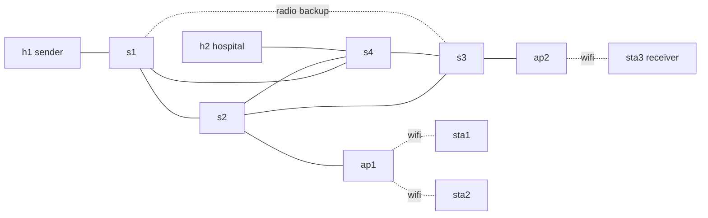

# Disaster-Resilient Communication Network
Automated link-failure detection and alternate-path recovery on a hybrid wired + wireless network (Mininet-WiFi, Open vSwitch, Wireshark).


## Topology (11 nodes)
| Type | Nodes |
|---|---|
| Hosts (wired) | h1 Command Centre (sender), h2 Hospital |
| Core switches (wired mesh) | s1, s2, s3, s4 |
| Access points (Wi-Fi) | ap1 (zoneA), ap2 (zoneB) |
| Stations (wireless) | sta1, sta2 (on ap1), sta3 Field Team (receiver, on ap2) |
| Radio backhaul | s1 to s3, 5 Mbps, 30 ms, 5% loss (last resort) |



## How recovery works
1. Dijkstra computes the lowest-cost path to every host and installs `ip,nw_dst` flow rules on s1 to s4 (`ovs-ofctl`).
2. A monitor thread polls the operational state of every core interface every 200 ms (the same signal an OpenFlow port-status event gives).
3. On any change it recomputes routes over the surviving links and overwrites the flows. Traffic moves to the next best path, ending on the radio backhaul if all wired paths to s3 are gone.

Path order h1 to sta3: `s1-s2-s3` then `s1-s4-s3` then `s1-s3 (radio)`.

## Setup (once)
```bash
./setup.sh            # Ubuntu VM, installs Mininet-WiFi, tcpdump, Wireshark
```

## Run
```bash
sudo python3 topology.py          # interactive
sudo python3 topology.py --auto   # scripted failure demo (about 62 s) + loss summary
```
Interactive commands:
```
mininet-wifi> h1 ping -c 5 sta3
mininet-wifi> link s2 s3 down      # watch the log reroute via s4
mininet-wifi> link s3 s4 down      # now only the radio link remains
mininet-wifi> link s2 s3 up
mininet-wifi> sta3 iperf -s &      then   h1 iperf -c 10.0.0.13
```

## Wireshark evidence
`captures/*.pcap` is written per core link. Open with `wireshark captures/s2-eth2.pcap` (names vary, use `ls captures`).
Filters: `icmp`, `icmp.resp_in`, `icmp && frame.time_delta_displayed > 0.5` (gaps during failover).
Compare which pcap files keep receiving ICMP before and after each failure to prove the path change.

## Regenerate diagram
```bash
python3 diagram.py
```

## Expected demo timeline (`--auto`)
| t (s) | Event | Expected path h1 to sta3 |
|---|---|---|
| 0 | start | s1-s2-s3 |
| 8 | s2-s3 down | s1-s4-s3 |
| 22 | s3-s4 down | s1-s3 (radio) |
| 38 | s2-s3 up | s1-s2-s3 |
| 48 | s3-s4 up | s1-s2-s3 |

## Note on wireless realism
Station to AP links are real emulated Wi-Fi (Mininet-WiFi). The s1-s3 radio backhaul is modelled as a shaped link (rate, delay, loss) because Mininet-WiFi does not give point-to-point AP mesh by default.

## Web simulator (Vercel)
`public/index.html` is a static page that simulates the same failover in the browser. `vercel.json` marks the repo as a static site (output folder `public`) and `.vercelignore` hides the Python files so Vercel does not try to build them.
