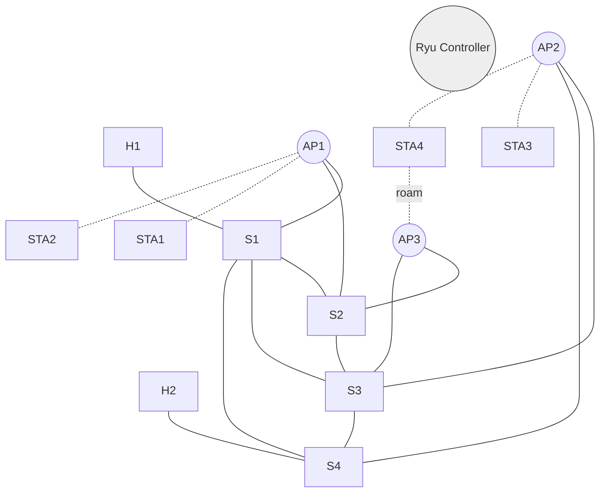

# Disaster-Resilient Communication Network
Automated link-failure detection and alternate-path recovery on a hybrid wired + wireless SDN, using Mininet-WiFi, Ryu and Wireshark.

## Topology



Solid = wired, dotted = wireless. 4 core switches, 3 APs, 2 wired hosts, 4 stations (19 nodes with controller excluded).

## Why packets still get delivered
| Layer | Redundancy |
|---|---|
| Wired core | Ring + chord: 2 or more paths between any two switches |
| AP backhaul | Every AP is wired to 2 different core switches |
| Wireless access | Overlapping AP coverage, stations can roam (sta4) |
| Control plane | Failure detected by LLDP/port status, Dijkstra recomputes, flows re-pushed |
| Transport | TCP retransmits the few packets lost during failover |

Note: guaranteed delivery is not possible during the failover window. Expect a short burst of loss for ICMP, which is what we measure.

## Setup (Ubuntu 20.04/22.04 VM)
```bash
git clone <your-repo-url> && cd disaster-resilient-network
bash scripts/setup.sh
```

## Run
Terminal 1 (controller):
```bash
bash scripts/run_controller.sh
```
Terminal 2 (network):
```bash
bash scripts/run_network.sh              # interactive CLI
bash scripts/run_network.sh --mobility   # sta4 roams ap2 -> ap3
bash scripts/run_network.sh --auto       # automated failover test
```

## Manual failure tests (Mininet CLI)
```
mininet-wifi> h1 ping sta3
mininet-wifi> link s1 s4 down        # wired link failure
mininet-wifi> link s1 s4 up
mininet-wifi> link ap2 s3 down       # AP uplink failure (other uplink takes over)
mininet-wifi> link s1 s2 down        # second core failure
mininet-wifi> h1 ping h2
mininet-wifi> sta1 ping sta3         # wireless to wireless across the core
mininet-wifi> h1 iperf -s &          # throughput before/during/after
mininet-wifi> sta3 iperf -c 10.0.0.1 -t 30
```
Watch the controller terminal for `LINK DOWN`, `PATH ...` and `RECOVERY: ... ms` lines.

## Wireshark
`--auto` writes `results/h1.pcap` and `results/sta3.pcap`.
| Goal | Filter |
|---|---|
| Ping loss window | `icmp` (look for gaps in `icmp.seq`) |
| Unanswered requests | `icmp && !icmp.resp_in` |
| LLDP discovery | `lldp` |
| OpenFlow (capture on `lo`) | `tcp.port == 6653` or `openflow_v4` |
| Flow rule pushes | `openflow_v4.type == 14` |
| Wireless side | capture on `sta3-wlan0` or `hwsim0` |

## Metrics to report
Detection time (controller log), recovery time (`RECOVERY: ... ms`), packets lost (`results/summary.txt`), throughput with iperf before/during/after.

## Troubleshooting
| Problem | Fix |
|---|---|
| `ryu-manager` import error with eventlet | `pip install eventlet==0.30.2` |
| `Cannot find required executable ovs-...` | `sudo service openvswitch-switch start` |
| Dirty state after a crash | `sudo mn -c` |
| Stations never associate | `sudo modprobe mac80211_hwsim`, use a VM, not default WSL2 |
| Ping works only after a few tries | Wait 3 to 5 s after start for LLDP discovery |

## Repo layout
```
topo.py            Mininet-WiFi topology + automated test
ryu_app/recovery.py  Ryu controller (detection + Dijkstra recovery)
scripts/           setup and run helpers
docs/topology.svg  topology diagram
results/           pcaps and summary output
```
